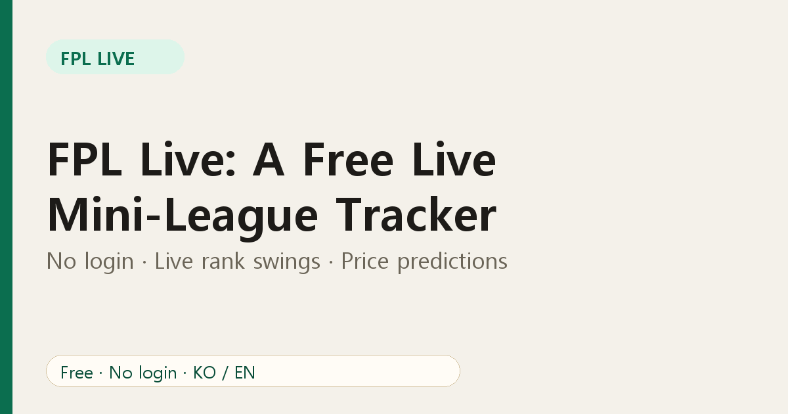

# FPL Live: A Free Live Mini-League Tracker (No Login Needed)

If you play Fantasy Premier League (FPL) with friends, you know the routine: matches kick off, goals go in, and you keep refreshing the app to see whether you just overtook your rival. **FPL Live** is a free web dashboard built for that moment. Enter a classic mini-league ID and you get live standings, rank swings, fixtures, transfer trends and price change predictions in one place.

## What FPL Live does

- **Live mini-league standings.** See every manager's gameweek score, including provisional bonus points, while matches are still being played.
- **Rank history.** See how each manager's rank has moved across the season, not just where it is today.
- **Teams view.** Fixtures, the Premier League table and a fixture-difficulty grid.
- **Players view.** Transfer trends, performance, and which players your own league owns.
- **Price change predictions.** Who is close to rising or falling, with filters.
- **Deadline banner** that shows the deadline in *your* time zone.
- **English and Korean**, switchable with one click.

## Why not just use the official app?

The official app is great for managing your squad. FPL Live is for *watching your league*. It is built around comparing you with the people you actually play against, rather than the whole world. It also needs no account, so you can send a link to a friend who has never signed up for anything.

## How to start in 20 seconds

1. Open [FPL Live](https://fpl-live-production-34f4.up.railway.app/?ref=blog-en-01).
2. Type your classic mini-league ID. Not sure where to find it? Read [how to find your FPL mini-league ID](02-find-fpl-mini-league-id.md).
3. Pick a tab: Standings, Teams or Players.

No league ID yet? Go straight to the [price change predictions page](https://fpl-live-production-34f4.up.railway.app/price-changes?ref=blog-en-01); it works without any league.

## Good to know

FPL Live uses the public data that the official FPL site exposes. It is an unofficial fan project and is not affiliated with the Premier League or Fantasy Premier League. Very large leagues can occasionally fail to load because the upstream service limits them. If something looks wrong, send feedback through the link in the page footer.

## FAQ

**Is FPL Live free?** Yes. There is no login or payment.

**Does it work on a phone?** Yes. The layout is designed to work at phone width.

**Which leagues are supported?** Public classic leagues, identified by their league ID.

**Where does the data come from?** From the official FPL data feeds, refreshed every short interval during live matches.

Ready to see your league move in real time? [Open FPL Live](https://fpl-live-production-34f4.up.railway.app/?ref=blog-en-01).
