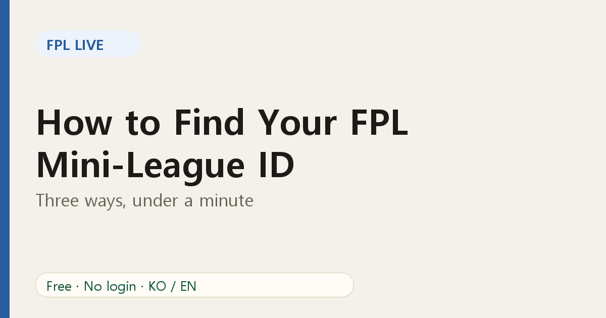
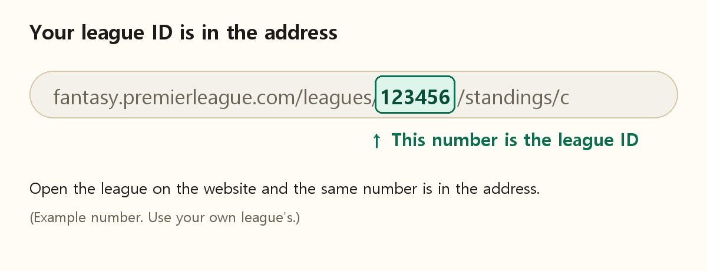

# How to Find Your FPL Mini-League ID in Under a Minute

Most FPL tools ask for one thing: your **mini-league ID**. It is just a number, but it is not obvious where to look. Here are the simplest ways to find it.

## Method 1: Read it from the website address

1. Sign in at the official Fantasy Premier League website.
2. Open the **Leagues & Cups** area and click your classic league.
3. Look at the address bar. The number after `/leagues/` is your league ID.

The number in the picture is only an example. Yours will be different.

## Method 2: Open the league from the mobile browser

If you only use the phone app, open the FPL website in your phone's browser, sign in, open the league and read the address the same way. The official app may not show the number directly, so the browser is the reliable route.

## Method 3: Ask the league admin

The admin who created the league can share the league's page link. The ID is inside the link. If your league has a join code, that code is different from the ID, so make sure you copy the number from the address.

## Use your ID in FPL Live

1. Go to [FPL Live](https://fpl-live-production-34f4.up.railway.app/?ref=blog-en-02).
2. Paste the number into the search box and press Enter.
3. Bookmark the page. The address contains your league ID, so you will land on the same league next time.

## Troubleshooting

- **"League not found."** Check that you copied only digits, with no spaces.
- **Private or head-to-head leagues.** FPL Live is built for classic leagues. Head-to-head leagues have a different structure.
- **Large leagues load slowly or fail.** The upstream service restricts very large leagues. Try a smaller friends league first.
- **Empty table.** Occasionally the official feed returns no standings for a league for a while. Try again later.

## FAQ

**Is the league ID secret?** It is not a password, but treat the league as private. Share the link only with people you want in.

**Can I follow several leagues?** Yes. Open each one with its own ID and bookmark them.

Don't have a league yet? Start with the [price change predictions page](https://fpl-live-production-34f4.up.railway.app/price-changes?ref=blog-en-02), which needs no ID, then read [our intro to FPL Live](01-fpl-live-free-mini-league-tracker.md).
