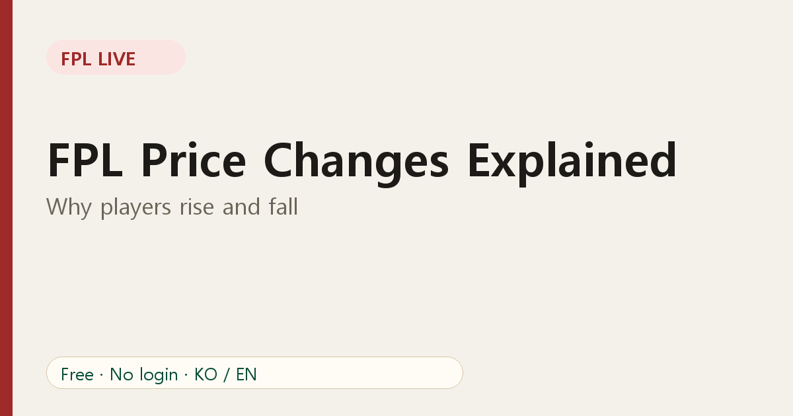
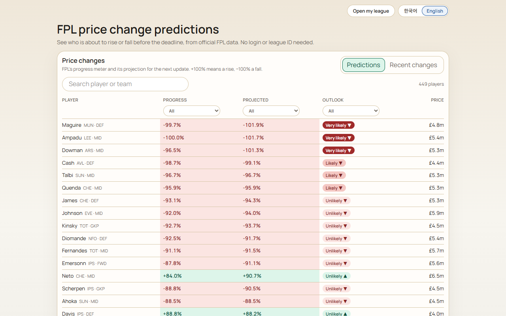

# FPL Price Changes Explained: Why Players Rise and Fall

Every Fantasy Premier League player has a price, and that price moves. A striker you bought at £8.0m may cost £8.3m a few weeks later. Understanding why helps you time transfers and protect your budget.

## The basic idea

Prices respond to **demand**. When many managers buy a player, his price tends to go up. When many sell him, it tends to go down. FPL does not publish the exact formula, so nobody outside the game can predict a move with certainty. What the game does show is a progress figure that tells you how close a player is to a change.

## Small steps, real money

Price moves happen in steps of £0.1m. That sounds tiny, but across a 15-player squad it adds up. A few early rises can be the difference between affording a premium player and not.

There is also a selling rule worth knowing: when you sell a player who has risen, you do not get the full profit. Roughly half of the gain is kept as profit, rounded down to the nearest £0.1m. So buying before a rise still helps, but the benefit is smaller than the headline price move suggests.

## What FPL Live shows you

The [price change predictions page](https://fpl-live-production-34f4.up.railway.app/price-changes?ref=blog-en-03) lists every player with:

- **Progress**: how far the player is toward a rise (positive) or a fall (negative).
- **Projected**: the game's projection of that progress at the next update.
- **Outlook**: our plain-language reading of the two numbers: very likely, likely or unlikely.

Rises are tinted green and falls red, so you can scan the list quickly. There are filters on each column and a name search.

## How to use it

1. **Before the deadline**, filter to the players you own and see if any are near a fall. Selling just before a fall protects your budget.
2. **Before buying a trending player**, check whether he is about to rise. If so, moving first can save you money.
3. **Don't chase tiny gains.** A transfer you would not make anyway is rarely worth making only for a price move.

## Limits to remember

Predictions are estimates. Prices can lag, and a player's progress can fall back if demand cools. Also, the public data does not give dated price-change history, so FPL Live shows recent changes since the last deadline, not a day-by-day log.

## FAQ

**Can a price change by more than £0.1m at once?** In normal play, moves are in £0.1m steps.

**Do injured players fall?** Often managers sell injured players, which can push the price down, but it depends on demand.

Continue with [how to read the predictions in detail](04-read-fpl-price-change-predictions.md).
