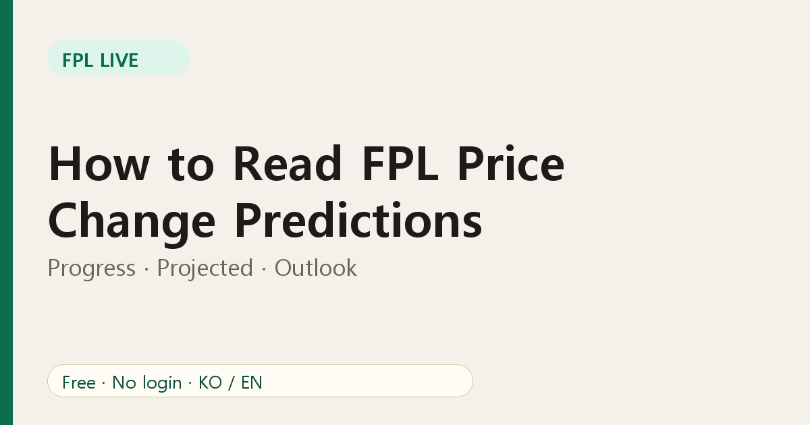
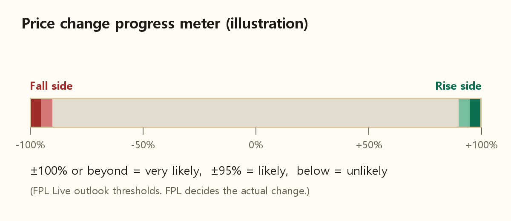

# How to Read FPL Price Change Predictions: Progress, Projected, Outlook

A price prediction table is only useful if you know what each column means. This guide walks through the one on FPL Live, so you can decide quickly instead of guessing.

## The progress meter

The official data gives every player a number from **-100% to +100%**. Think of it as a meter. At +100% the player is due a rise, at -100% a fall. Close to zero means little pressure either way.

## The three columns

**Progress** is where the meter is right now.

**Projected** is the game's own projection of the meter at the next update. If projected is further from zero than progress, pressure is building. If it is closer, the player may cool off.

**Outlook** is our summary of the projected figure:

- **Very likely**: projected is at or beyond ±100%.
- **Likely**: projected is at or beyond ±95%.
- **Unlikely**: anything lower.

We chose these cut-offs by comparing against the official price-changes page. They are a guide, not a guarantee; FPL decides the actual change.

## Filtering the table

Every column has its own filter:

- Progress and Projected: all, rises, falls, ±95% or more, ±100% or more.
- Outlook: all, very likely, likely, unlikely, or locked.
- A name box searches players and teams.

A useful combination: set **Outlook = Likely**, then look only at rises if you want to buy, or falls if you want to sell.

## Locked players

Some players are temporarily locked from changing price. The Outlook filter has a "locked" option so you can exclude them from your shortlist.

## A simple routine

1. Open the [predictions page](https://fpl-live-production-34f4.up.railway.app/price-changes?ref=blog-en-04) before the deadline.
2. Filter to **falls**, search your own players, and note any that are very likely to drop.
3. Filter to **rises** and see whether a player you want is about to cost more.
4. Decide, then move on. Do not obsess over every 0.1.

## FAQ

**Why do two players with the same progress have different outlooks?** The outlook uses the projected figure, not just the current one.

**Does the table update live?** It refreshes regularly while the page is open.

Next, see [why prices move at all](03-fpl-price-changes-explained.md).
