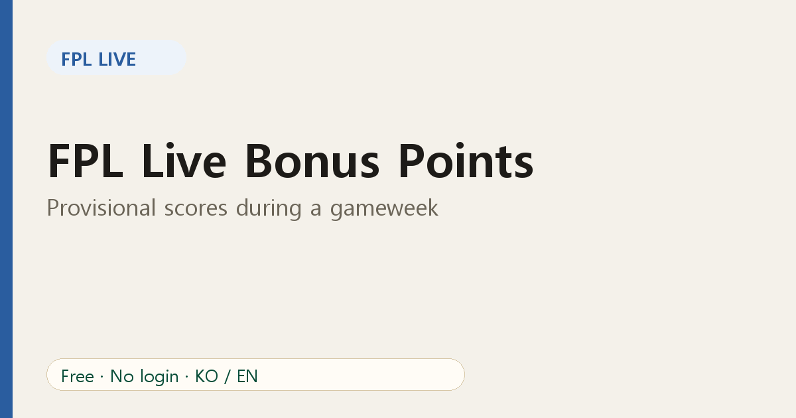
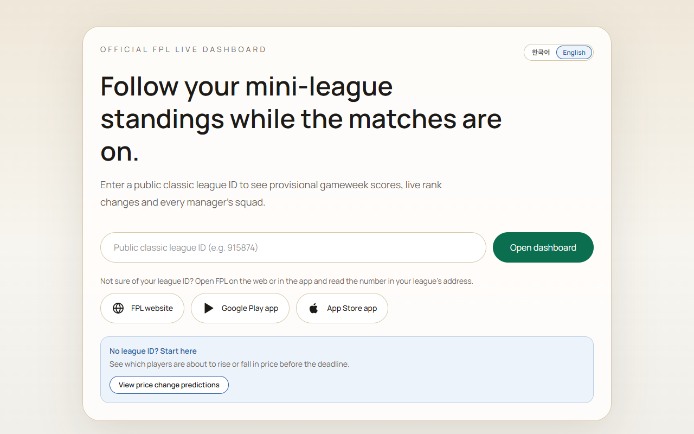

# FPL Live Bonus Points: Provisional Scores During a Gameweek

You are third in your mini-league, a goal goes in, and suddenly you are first. Then the final whistle blows and you drop back a place. What happened? Usually, **bonus points**.

## How bonus points work

After each match, the three best performers according to the Bonus Points System (BPS) receive 3, 2 and 1 bonus points. BPS rewards things like goals, assists, clean sheets and key actions on the pitch.

The catch is timing: bonus points are confirmed after the match ends. During the game, the official live numbers may not include them yet.

## Provisional scores

FPL Live calculates **provisional bonus points** from the in-play BPS data and adds them to each manager's gameweek score while matches are on. That is why the live table can look different from a screen that only shows confirmed points.

Provisional means exactly that: the order of BPS can change until the final whistle, and the official figure is what counts at the end. Treat a one-point gap as a coin flip until the matches finish.

## Why your rank moves

Your rank in a mini-league can change because of:

1. **Goals and assists** by players in your squad.
2. **Provisional bonus** shifting between players.
3. **Captain** points, which count double.
4. **Auto-substitutions**, which are applied when a starter does not play.

Seeing the table with provisional bonus included gives you a truer picture of where you stand.

## How to use this during a weekend

- Open your league at kick-off and watch the Standings tab.
- When a close rival has a player in a tight bonus race, expect swings late in the match.
- Check the [rank history](06-track-mini-league-rank-swings.md) afterwards to see where the gameweek really moved you.

## FAQ

**Are provisional points official?** No. Official points are confirmed by FPL after matches.

**Why did my score change after full time?** Bonus points were confirmed, or a late correction was applied.

Try it on your league: [open FPL Live](https://fpl-live-production-34f4.up.railway.app/?ref=blog-en-05).
