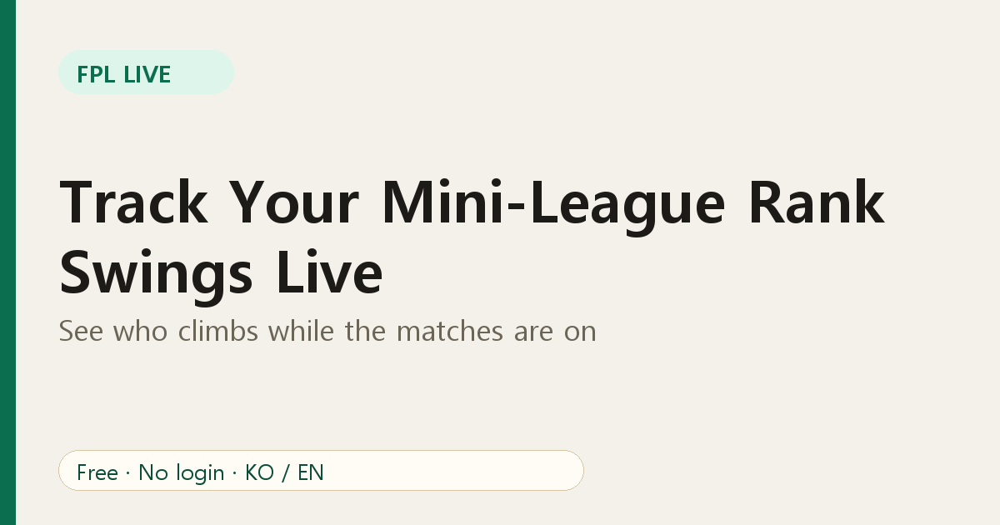
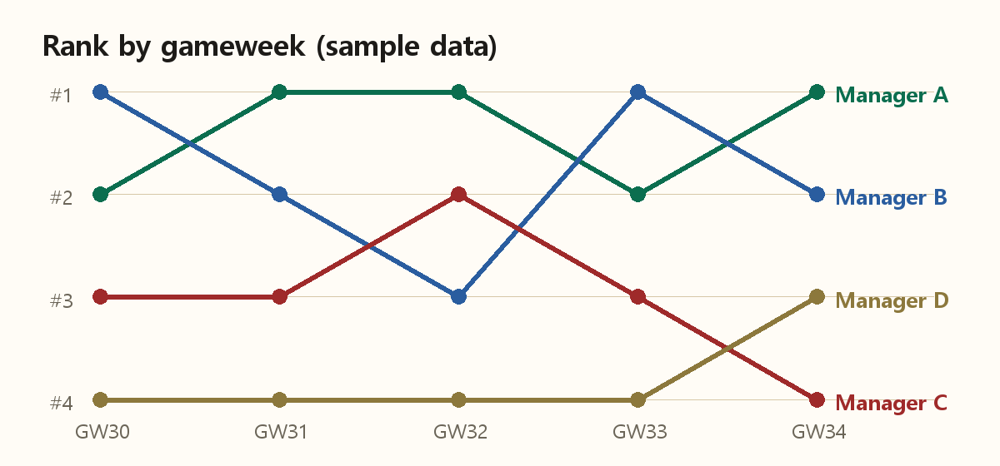

# Track Your Mini-League Rank Swings Live

Your total points tell you where you are. Your **rank history** tells you where you are *heading*. FPL Live gives you both, for the people you actually compete against.

## Two kinds of movement

**During a gameweek**, ranks move as goals, assists and bonus points arrive. The Standings tab shows the live order using provisional scores, so you can see who is climbing while the matches are on.

**Across the season**, the rank-history view plots each manager's position gameweek by gameweek.

The chart above is sample data to show the idea: Manager A led early, B dipped and came back, and C slid down the table.

## What to look for

1. **Momentum.** A manager who has climbed three gameweeks in a row is in form, or has found a template that works. Look at what they own.
2. **Volatility.** A line that zigzags usually means a high-risk style: big captains, differentials, chips. Those managers can jump or crash.
3. **Gaps.** A rival one place above you is a target. A rival five places below is a warning only if their line is rising.

## How to use it in practice

- After each gameweek, open the rank-history tab and note who gained most.
- Compare squads with that manager through the league's player view, then ask why they scored more.
- Keep a simple goal: gain one place per month. Small targets keep a long season interesting.

## During the match

Open your league during a match day, keep the tab visible and use the refresh button for a fresh pull. The standings refresh automatically, but a manual refresh is handy right after a goal.

## FAQ

**Does rank history need a login?** No. Only the league ID.

**Why does a rank change after the final whistle?** Provisional bonus is replaced by the official bonus. See [our bonus points explainer](05-fpl-live-bonus-points-provisional.md).

Open your league: [FPL Live](https://fpl-live-production-34f4.up.railway.app/?ref=blog-en-06).
