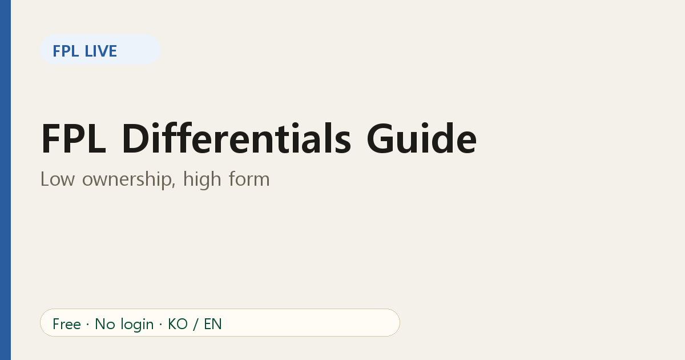
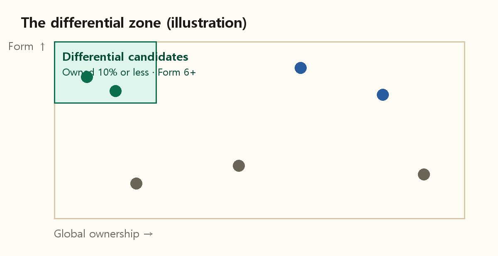

# FPL Differentials: How to Find Low-Owned Players Worth Backing

If everyone in your mini-league owns the same players, the table barely moves. To overtake a rival you need to score points **they don't have**. That is the idea behind a *differential*.

## What is a differential?

A differential is a player owned by few managers who can still return points. The fewer people who own him, the more a good score helps you relative to everyone else.

## A simple definition

In FPL Live, we flag a differential as a player who is:

- **owned by 10% of managers or fewer** worldwide, and
- **in good form**, with a form score of 6 or higher.

Those numbers are our defaults, not a rule of the game. You can tighten or loosen them in your own head: 5% ownership is bolder, 15% is safer.

## Global vs league differentials

A player can be a differential in the world but not in your league, or the reverse. If five of your seven rivals own a player, he is not a differential *for you*, even if only 8% of the world owns him. That is why the league player view exists: it shows who owns what among the managers you care about.

## How to pick one

1. Start from form, not just price. A cheap non-scorer is not a differential, just a dud.
2. Check fixtures in the [Teams view](https://fpl-live-production-34f4.up.railway.app/?ref=blog-en-07) for the next few gameweeks.
3. Check minutes. A player on the bench scores no points.
4. Compare with rivals: if the gap above you is small, one differential can close it.

## Risk management

Differentials are higher variance by nature. Keep most of your squad solid and use one or two differential slots. If you are comfortably ahead in your league, play it safer; if you are chasing, take more risk.

## FAQ

**Is a differential always a cheap player?** No. Premium players can be differentials too.

**How long should I hold one?** Until form or fixtures turn, not for a fixed number of weeks.

Related: [effective ownership and captaincy](08-fpl-effective-ownership-captain.md).
