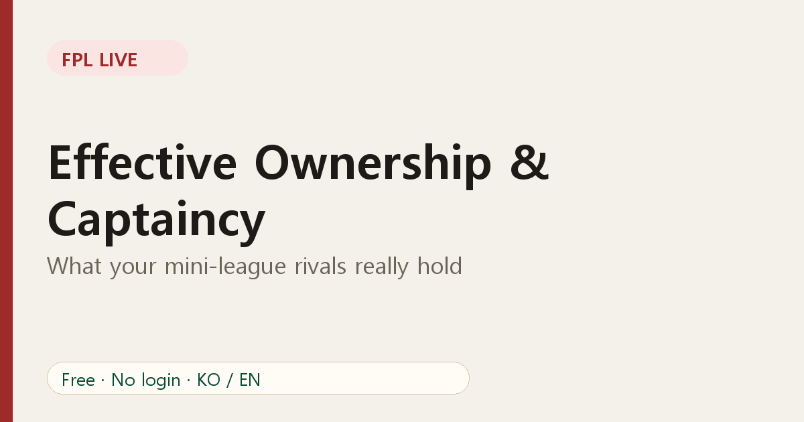

# Effective Ownership and Captaincy in Your Mini-League

Ownership percentage is a blunt number. It counts how many squads *contain* a player, but not how much that player *matters* to each squad. **Effective ownership (EO)** fixes that.

## What EO measures

EO counts a player's share of points taken by a group of managers, including captaincy:

- A starter counts once.
- A captain counts twice, because captain points are doubled.
- A bench player counts as zero for that gameweek.

So a player owned by 40% but captained by half of them has an EO well above 40%. In a mini-league, you can compute the same idea across only the managers you play against.

## Why it matters

Imagine a rival captains a striker and you don't own him. If he scores a big haul, they gain double points and you gain nothing. EO makes that exposure visible *before* the match.

## Reading it in your league

The league player view lists who owns each player, who captains him and how many are starting him. Use it to answer:

1. **Who is the league's most-owned player?** If you skip him, you are taking a differential-style risk.
2. **Who is the league's most-captained player?** If you don't captain him, you need your own pick to outscore him.
3. **Where am I exposed?** Players your rivals own and you don't are your biggest downside.

## A practical captain decision

- If you are **leading**, lean toward the same captain as your closest rivals. That neutralises their upside.
- If you are **chasing**, consider a different captain, accepting the extra variance.
- Always weigh fixture and minutes. EO is context, not a reason to captain a player who may not start.

## Limits

EO does not know who will actually play or who will be auto-substituted. It is a snapshot of selections. Use it alongside [differentials](07-fpl-differentials-guide.md) and your own judgement.

## FAQ

**Is EO an official stat?** The idea is common in the FPL community; the numbers on FPL Live are computed from your league's squads.

**Does the vice-captain count?** Only if the captain does not play, which cannot be known beforehand.

See the numbers for your own league: [open FPL Live](https://fpl-live-production-34f4.up.railway.app/?ref=blog-en-08).
