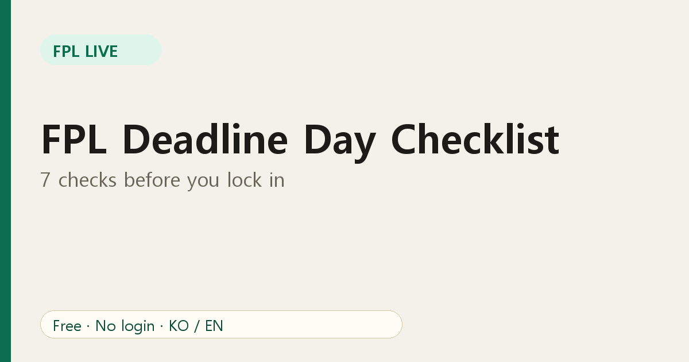
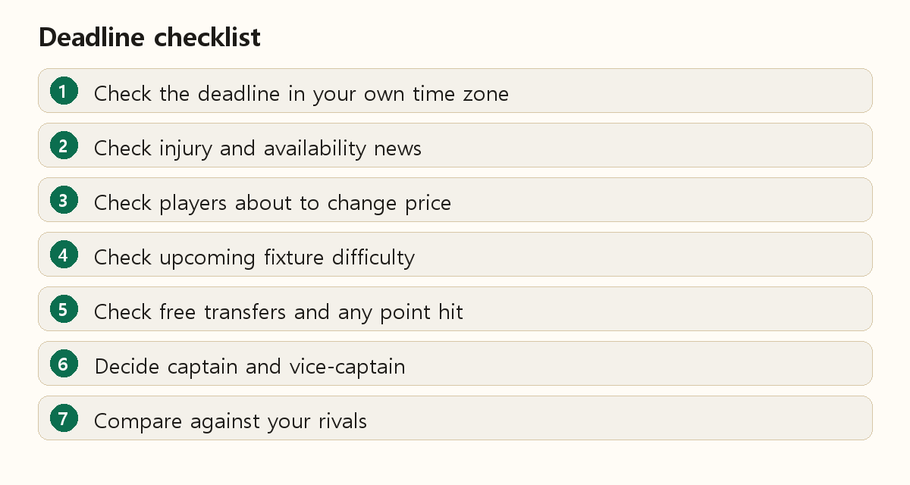

# FPL Deadline Day Checklist: 7 Checks Before You Lock In

Most FPL regrets happen in the last ten minutes before the deadline: a missed injury, a forgotten captain, a transfer made in a hurry. A short routine fixes most of them. Here is one you can run in five minutes.

## 1. Confirm the deadline in your time zone

The deadline is usually about 90 minutes before the first match of the gameweek, but it can vary. FPL Live's banner shows it in *your* local time with a countdown, which avoids time-zone mistakes.

## 2. Check injury and availability news

Look for flagged players in your squad. A player who is doubtful may play, but the risk is yours. Replace anyone confirmed out.

## 3. Check players about to change price

Open the [price change predictions](https://fpl-live-production-34f4.up.railway.app/price-changes?ref=blog-en-09). If a player you plan to buy is very likely to rise, moving now helps. If a player you plan to sell is very likely to fall, selling first protects your budget. Details in [our predictions guide](04-read-fpl-price-change-predictions.md).

## 4. Check upcoming fixtures

Use the Teams view's fixture-difficulty grid to compare the next several gameweeks. A good run of fixtures matters more than one easy match.

## 5. Count free transfers and any point hit

A hit costs points. Make sure a transfer really gains more than it costs over the next few gameweeks.

## 6. Decide captain and vice-captain

Choose a captain with minutes, form and a good fixture. A vice-captain protects you if your captain does not play.

## 7. Compare with your rivals

Check the league player view for what your rivals own and captain. If you are leading, reduce differences; if you are chasing, pick your spots. See [effective ownership](08-fpl-effective-ownership-captain.md).

## Finish with a calm look

Open your squad one last time, verify the starting eleven and bench order, and confirm the transfers went through. Then close the app and enjoy the matches.

## FAQ

**Can I change my team after the deadline?** Not for that gameweek, apart from chips already activated.

**What if I forget?** Your previous team carries over, but you lose the chance to react to news.

Set up your league view before kick-off: [FPL Live](https://fpl-live-production-34f4.up.railway.app/?ref=blog-en-09).
