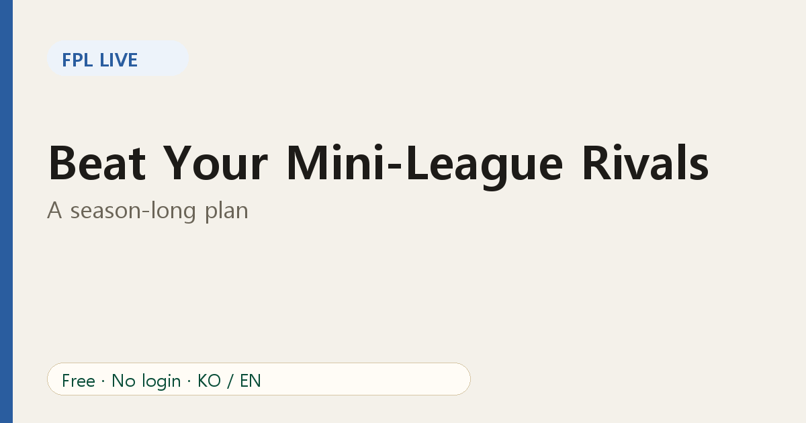

# How to Beat Your Mini-League Rivals: A Season-Long Plan

Winning the world is nearly impossible. Winning your **mini-league** is a real goal. The difference is that you can study the exact people you are racing. Here is a plan for the season.

## Phase 1: Learn your league (first month)

- Open your league in [FPL Live](https://fpl-live-production-34f4.up.railway.app/?ref=blog-en-10) and note who plays which style: safe template, risk-taker, chip user.
- Check the league player view to see what everybody owns.
- Do not try to win yet. Avoid big hits and build a solid squad.

## Phase 2: Build an edge (months two to four)

- **Use price changes.** Small budget gains add up. See [how price changes work](03-fpl-price-changes-explained.md).
- **Pick differentials with purpose.** One or two slots, chosen for form and fixtures. See [the differentials guide](07-fpl-differentials-guide.md).
- **Watch captain choices.** Your captain is the biggest single decision of every week. See [effective ownership](08-fpl-effective-ownership-captain.md).

## Phase 3: Manage the race (months five to seven)

Use the [rank history](06-track-mini-league-rank-swings.md) to see the trend, not just the table.

- **If you lead:** reduce variance. Mirror your nearest rivals' captains and avoid unnecessary hits.
- **If you chase:** increase variance. More differentials, bolder captains, well-timed chips.
- **If you are in the middle:** pick one rival above you as the target and beat them head to head.

## Phase 4: Finish strong (final stretch)

- Plan transfers around blank and double gameweeks early.
- Check the [deadline checklist](09-fpl-deadline-day-checklist.md) every week; the margins are small now.
- Keep the table visible on match days to see swings as they happen.

## Keep it fun

A mini-league is a social game. Share the live link with friends, trade banter and celebrate good calls. A league that stays fun is a league that stays alive all season.

## A one-page routine

| When | Do this |
|---|---|
| After each deadline | Look at what rivals own and captain |
| Before each deadline | Check price changes, news and fixtures |
| During matches | Watch live standings |
| After each gameweek | Review rank history and adjust the plan |

## FAQ

**Do I need paid tools?** No. FPL Live is free and needs no login.

**What if my league is huge?** Very large leagues may not load. Make a small friends league to track closely.

Start today: [open FPL Live](https://fpl-live-production-34f4.up.railway.app/?ref=blog-en-10).
