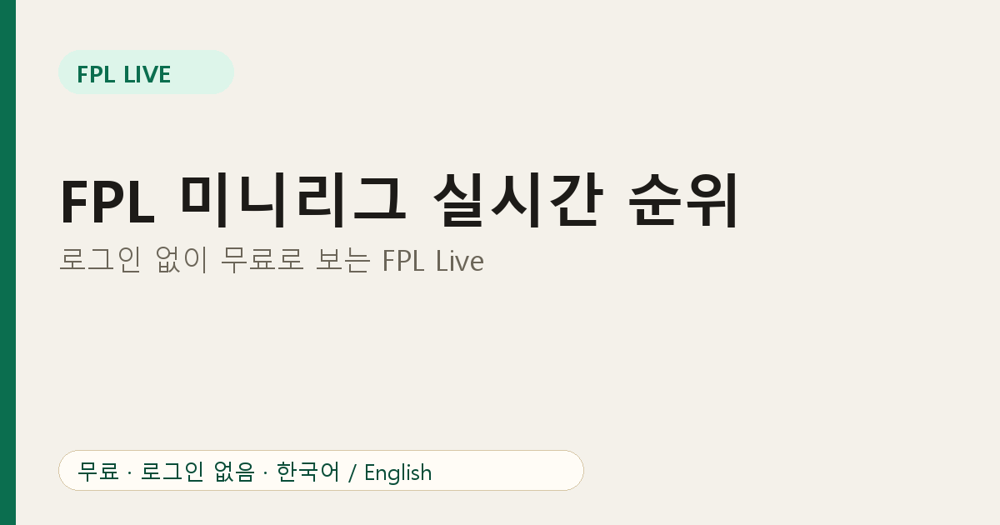

# FPL 미니리그 실시간 순위, 로그인 없이 무료로 보는 방법 (FPL Live 소개)

친구들과 판타지 프리미어리그(FPL)를 하다 보면 경기 중에 앱을 계속 새로고침하게 됩니다. "방금 골 들어갔는데 내가 1등 됐나?" 이 순간을 위해 만든 무료 웹 서비스가 **FPL Live**입니다. 미니리그 ID만 입력하면 실시간 순위, 순위 추이, 경기 일정, 선수 이적 시장, 가격 변동 예측을 한 화면에서 볼 수 있습니다.

## FPL Live로 할 수 있는 것

- **미니리그 실시간 순위**: 경기가 진행되는 동안 잠정 보너스 점수까지 반영한 게임위크 점수를 봅니다.
- **순위 추이**: 시즌 동안 매니저별 순위가 어떻게 움직였는지 확인합니다.
- **팀 메뉴**: EPL 경기 일정, 순위표, 일정 난이도를 한눈에 봅니다.
- **선수 메뉴**: 이적 시장, 선수 성과, 우리 리그에서 많이 보유한 선수를 봅니다.
- **가격 변동 예측**: 오를 선수와 내릴 선수를 필터로 골라 봅니다.
- **마감 시간 배너**: 내 시간대 기준으로 마감 시각과 남은 시간을 보여 줍니다.
- **한국어/영어 전환**

## 공식 앱과 무엇이 다른가요?

공식 앱은 내 스쿼드를 관리하는 데 최적입니다. FPL Live는 **내 리그를 지켜보는 데** 초점을 맞췄습니다. 전 세계 순위보다 함께 경쟁하는 친구들과의 비교가 중심이고, 로그인이 필요 없어서 링크 하나로 친구에게 공유할 수 있습니다.

## 20초 만에 시작하기

1. [FPL Live](https://fpl-live-production-34f4.up.railway.app/?ref=blog-ko-01)에 접속합니다.
2. 클래식 미니리그 ID를 입력합니다. ID를 모르면 [FPL 리그 ID 확인하는 법](02-fpl-league-id-check.md)을 보세요.
3. 주간 순위, 팀, 선수 탭을 눌러 봅니다.

리그 ID가 없어도 [가격 변동 예측 페이지](https://fpl-live-production-34f4.up.railway.app/price-changes?ref=blog-ko-01)는 바로 쓸 수 있습니다.

## 알아 두세요

FPL Live는 FPL 공식 사이트가 공개한 데이터를 사용하는 **비공식 팬 서비스**이며 프리미어리그, FPL과 제휴 관계가 없습니다. 아주 큰 리그는 공식 서버 제한으로 불러오지 못할 수 있습니다. 문제가 있으면 페이지 하단의 피드백 링크로 알려 주세요.

## 자주 묻는 질문

**무료인가요?** 네, 로그인과 결제가 없습니다.

**휴대폰에서도 되나요?** 네, 모바일 화면에 맞게 만들었습니다.

**어떤 리그를 볼 수 있나요?** 리그 ID로 조회하는 공개 클래식 리그입니다.

지금 [FPL Live](https://fpl-live-production-34f4.up.railway.app/?ref=blog-ko-01)에서 우리 리그를 열어 보세요.
