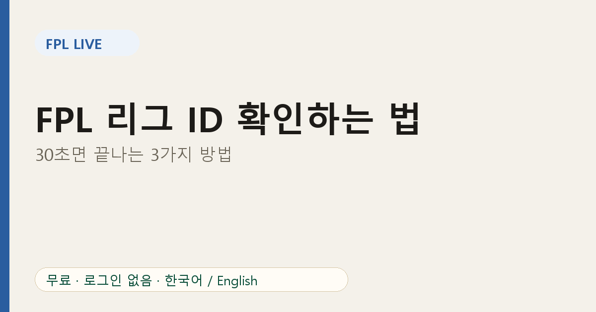
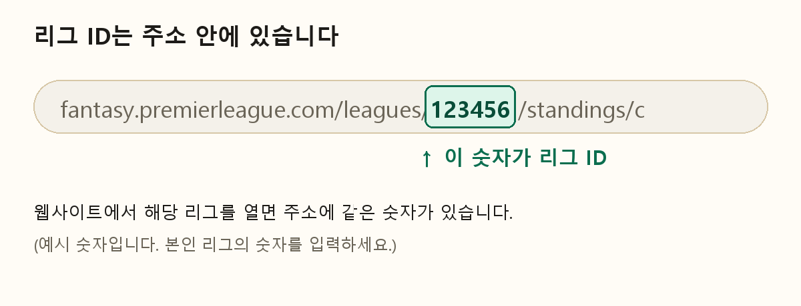
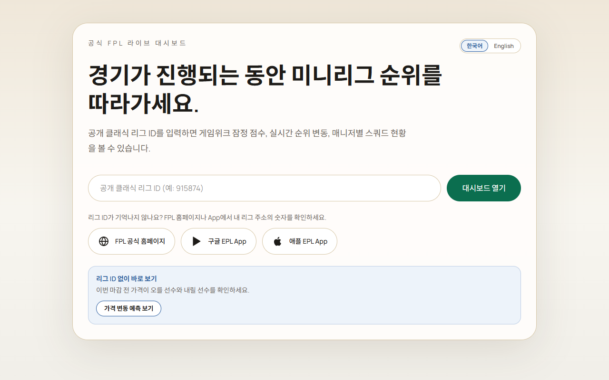

# FPL 리그 ID 확인하는 법: 30초면 끝나는 3가지 방법

대부분의 FPL 도구는 **미니리그 ID** 하나만 요구합니다. 그런데 이 숫자가 어디 있는지 찾기가 의외로 어렵습니다. 가장 쉬운 방법 세 가지를 소개합니다.

## 방법 1. 웹사이트 주소창에서 확인

1. 공식 판타지 프리미어리그 웹사이트에 로그인합니다.
2. **Leagues & Cups** 메뉴에서 내 클래식 리그를 클릭합니다.
3. 주소창에서 `/leagues/` 뒤에 있는 숫자가 리그 ID입니다.

그림의 숫자는 예시입니다. 본인 리그의 숫자를 확인하세요.

## 방법 2. 모바일 브라우저로 열기

앱만 쓰고 있다면 휴대폰 브라우저에서 FPL 웹사이트에 로그인해 리그를 열고 주소를 확인하세요. 앱에서는 숫자가 바로 보이지 않을 수 있어서 브라우저가 가장 확실합니다.

## 방법 3. 리그 운영자에게 받기

리그를 만든 운영자에게 리그 페이지 링크를 받으면 링크 안에 ID가 들어 있습니다. 참가 코드(join code)는 ID와 다른 값이니, 주소에 있는 숫자를 복사하세요.

## FPL Live에서 사용하기

1. [FPL Live](https://fpl-live-production-34f4.up.railway.app/?ref=blog-ko-02)에 접속합니다.
2. 입력창에 숫자를 붙여 넣고 Enter를 누릅니다.
3. 주소를 북마크해 두면 다음에 바로 같은 리그가 열립니다.

## 문제가 생기면

- **"리그를 찾을 수 없음"**: 공백 없이 숫자만 복사했는지 확인하세요.
- **헤드투헤드 리그**: FPL Live는 클래식 리그용입니다.
- **큰 리그가 안 열림**: 공식 서버가 아주 큰 리그의 조회를 제한합니다. 친구 리그부터 시도해 보세요.
- **순위표가 비어 있음**: 공식 데이터가 일시적으로 비어 있을 수 있습니다. 잠시 후 다시 시도하세요.

## 자주 묻는 질문

**리그 ID는 비밀번호인가요?** 아닙니다. 그래도 비공개로 운영하는 리그라면 링크는 믿을 만한 사람에게만 공유하세요.

**여러 리그를 볼 수 있나요?** 네, 리그마다 ID를 입력하고 북마크해 두면 됩니다.

리그가 아직 없다면 ID 없이 쓰는 [가격 변동 예측 페이지](https://fpl-live-production-34f4.up.railway.app/price-changes?ref=blog-ko-02)부터 보세요. 서비스 전체 소개는 [FPL Live 소개 글](01-fpl-live-minileague-realtime-ranking.md)에 있습니다.
