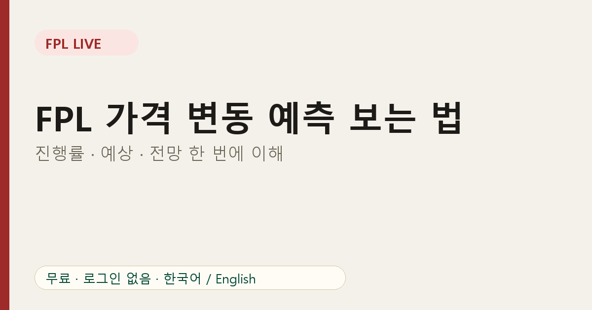
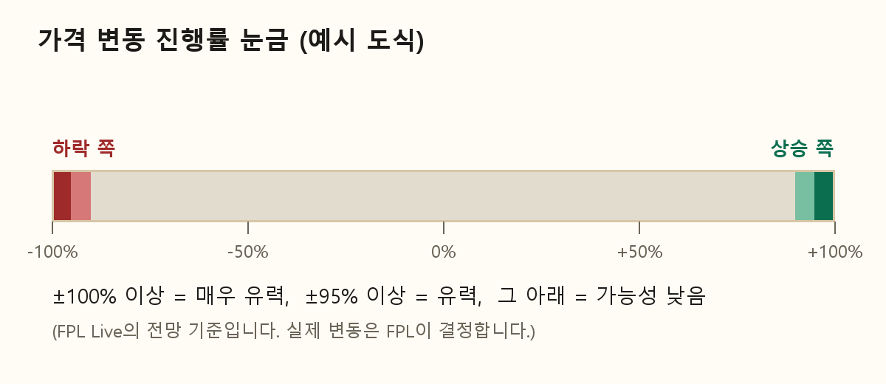

# FPL 가격 변동 예측 보는 법: 진행률·예상·전망 한 번에 이해하기

가격 예측 표는 각 열의 의미를 알아야 쓸모가 있습니다. FPL Live의 표를 기준으로 하나씩 풀어 드립니다.

## 진행률 눈금

공식 데이터는 선수마다 **-100%에서 +100%** 사이의 숫자를 줍니다. 눈금이라고 생각하세요. +100%면 상승, -100%면 하락이 임박한 상태이고, 0에 가까우면 어느 쪽 압력도 작습니다.

## 세 가지 열

**진행률**은 지금 눈금이 어디 있는지입니다.

**예상**은 다음 가격 갱신 시점의 진행률에 대한 공식 예측치입니다. 예상이 진행률보다 0에서 더 멀면 압력이 커지고 있다는 뜻이고, 더 가까우면 열기가 식는 중입니다.

**전망**은 예상 값을 우리가 읽기 쉽게 요약한 것입니다.

- **매우 유력**: 예상이 ±100% 이상
- **유력**: 예상이 ±95% 이상
- **가능성 낮음**: 그 미만

기준은 공식 가격 변동 페이지와 비교해 맞춘 값이며, 참고용입니다. 실제 변동은 FPL이 결정합니다.

## 필터 사용법

각 열에 필터가 있습니다.

- 진행률, 예상: 전체, 상승, 하락, ±95% 이상, ±100% 이상
- 전망: 전체, 매우 유력, 유력, 가능성 낮음, 잠금
- 이름 검색창: 선수나 팀 이름을 찾습니다.

추천 조합은 **전망 = 유력**으로 두고 살 때는 상승만, 팔 때는 하락만 보는 방식입니다.

## 잠금 상태

일시적으로 가격이 바뀌지 않도록 잠긴 선수가 있습니다. 전망 필터의 "잠금"으로 후보에서 걸러 낼 수 있습니다.

## 간단한 루틴

1. 마감 전에 [가격 변동 예측 페이지](https://fpl-live-production-34f4.up.railway.app/price-changes?ref=blog-ko-03)를 엽니다.
2. **하락**으로 필터하고 내 선수 이름을 검색해 곧 내릴 선수를 확인합니다.
3. **상승**으로 필터하고 사고 싶은 선수가 곧 오르는지 확인합니다.
4. 결정하고 넘어가세요. 0.1에 집착하지 않는 것이 중요합니다.

## 자주 묻는 질문

**진행률이 같은데 전망이 다른 이유는?** 전망은 현재 값이 아니라 예상 값을 기준으로 하기 때문입니다.

**실시간으로 갱신되나요?** 페이지를 열어 둔 동안 주기적으로 갱신됩니다.

가격이 왜 움직이는지는 [FPL 가격 변동 원리](04-fpl-price-rise-fall-principle.md)에서 설명합니다.
