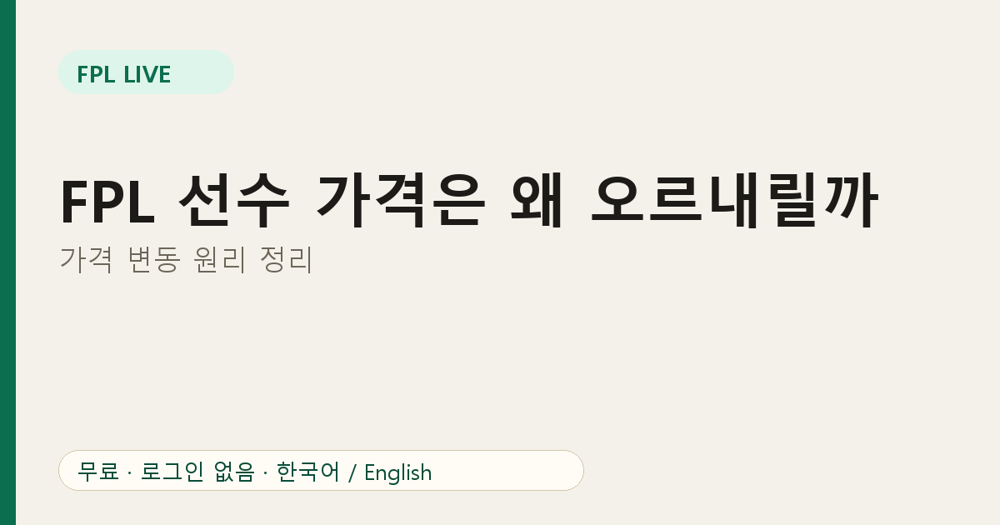
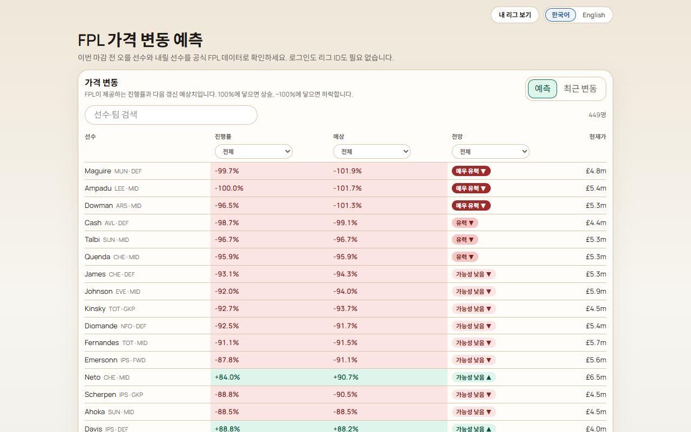

# FPL 선수 가격은 왜 오르고 내릴까? 가격 변동 원리 정리

FPL의 모든 선수에게는 가격이 있고, 그 가격은 시즌 중에 움직입니다. 8.0m에 산 공격수가 몇 주 뒤 8.3m이 되기도 합니다. 이유를 알면 이적 타이밍과 예산 관리가 쉬워집니다.

## 기본 원리: 수요

가격은 **수요**에 반응합니다. 많은 매니저가 선수를 사면 가격이 오르고, 많이 팔면 내려가는 경향이 있습니다. 정확한 공식은 공개되지 않아서 누구도 확실히 예측할 수는 없습니다. 대신 게임은 변동이 얼마나 가까운지 보여 주는 진행률 수치를 제공합니다.

## 작은 단위, 큰 차이

가격은 0.1m 단위로 움직입니다. 작아 보이지만 15명 스쿼드 전체로 보면 누적됩니다. 초반 몇 번의 상승이 프리미엄 선수를 살 수 있느냐를 가르기도 합니다.

판매 규칙도 알아 두세요. 오른 선수를 팔 때는 이익 전체가 아니라 대략 **절반**만 내 몫이 되고 0.1m 단위로 내림 처리됩니다. 그래서 오르기 전에 사는 것은 도움이 되지만 눈에 보이는 가격 상승만큼은 아닙니다.

## FPL Live에서 보이는 것

[가격 변동 예측 페이지](https://fpl-live-production-34f4.up.railway.app/price-changes?ref=blog-ko-04)에는 선수별로 다음이 표시됩니다.

- **진행률**: 상승(양수) 또는 하락(음수)까지 얼마나 왔는지
- **예상**: 다음 갱신 시점의 예상 진행률
- **전망**: 두 수치를 읽기 쉽게 요약한 값 (매우 유력, 유력, 가능성 낮음)

상승은 초록, 하락은 빨강으로 구분해서 한눈에 훑어볼 수 있고, 열마다 필터와 이름 검색이 있습니다.

## 활용 방법

1. **마감 전**에 내 선수 중 곧 떨어질 선수가 있는지 확인합니다. 먼저 팔면 예산을 지킬 수 있습니다.
2. **인기 선수를 사기 전에** 곧 오르는지 확인합니다. 오르기 전에 사면 이득입니다.
3. **가격 때문에만 이적하지 마세요.** 어차피 하지 않을 이적이라면 가격 이득은 작습니다.

## 한계

예측은 추정입니다. 수요가 식으면 진행률이 되돌아갈 수 있고, 반영이 늦을 수도 있습니다. 또 공개 데이터에는 날짜별 가격 변동 기록이 없어서, FPL Live의 "최근 변동"은 지난 마감 이후의 변동만 보여 줍니다.

## 자주 묻는 질문

**한 번에 0.1m보다 크게 바뀌나요?** 일반적으로 0.1m 단위입니다.

**부상 선수는 내려가나요?** 많이 팔리면 내려갈 수 있지만 수요에 달려 있습니다.

다음 글: [가격 변동 예측 보는 법](03-fpl-price-change-prediction.md)
