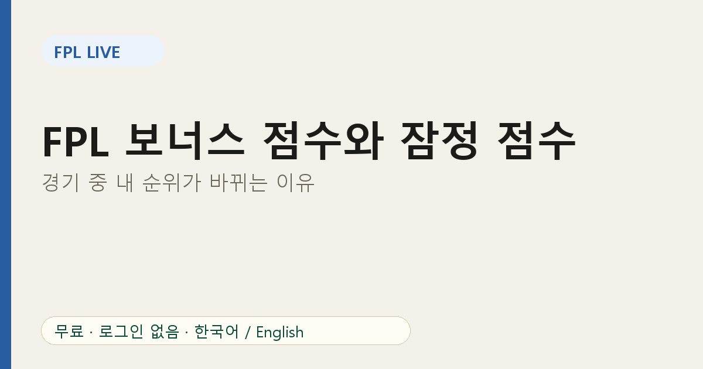

# FPL 보너스 점수와 잠정 점수: 경기 중 내 순위가 바뀌는 이유

미니리그 3등이었는데 골이 터지자 1등이 됐다가, 경기가 끝나자 다시 한 칸 내려갔다면? 대부분 **보너스 점수** 때문입니다.

## 보너스 점수 제도

경기가 끝나면 보너스 점수 시스템(BPS)에서 가장 좋은 활약을 한 세 명에게 3점, 2점, 1점이 주어집니다. BPS는 골, 어시스트, 클린시트 같은 경기 내 행동을 점수화합니다.

문제는 시점입니다. 보너스는 **경기가 끝난 뒤 확정**되므로, 경기 중 공식 라이브 숫자에는 아직 반영되지 않을 수 있습니다.

## 잠정 점수

FPL Live는 경기 중 BPS 데이터로 **잠정 보너스 점수**를 계산해 각 매니저의 게임위크 점수에 더해 보여 줍니다. 그래서 확정 점수만 보여 주는 화면보다 실제 순위에 가까운 그림을 볼 수 있습니다.

잠정은 말 그대로 잠정입니다. 종료 휘슬 전까지 BPS 순서가 바뀔 수 있고, 최종 기준은 공식 점수입니다. 1점 차이는 경기가 끝나기 전까지 동전 던지기라고 생각하세요.

## 순위가 움직이는 이유

1. 내 스쿼드 선수의 **골과 어시스트**
2. 선수 사이에서 이동하는 **잠정 보너스**
3. 두 배로 계산되는 **캡틴 점수**
4. 결장한 선발 선수를 대체하는 **자동 교체**

잠정 보너스까지 반영된 표를 보면 지금 위치를 더 정확히 알 수 있습니다.

## 경기 주말 활용법

- 킥오프 때 리그를 열고 주간 순위 탭을 지켜봅니다.
- 라이벌 선수가 보너스 경쟁 중이면 경기 후반에 변동이 생길 수 있습니다.
- 경기 후에는 [순위 추이](06-fpl-minileague-rank-trend.md)로 이번 주에 실제로 얼마나 움직였는지 확인합니다.

## 자주 묻는 질문

**잠정 점수는 공식 점수인가요?** 아닙니다. 공식 점수는 경기 후 FPL이 확정합니다.

**종료 후 점수가 바뀐 이유는?** 보너스가 확정되었거나 사후 정정이 적용된 것입니다.

내 리그로 확인해 보세요: [FPL Live](https://fpl-live-production-34f4.up.railway.app/?ref=blog-ko-05)
