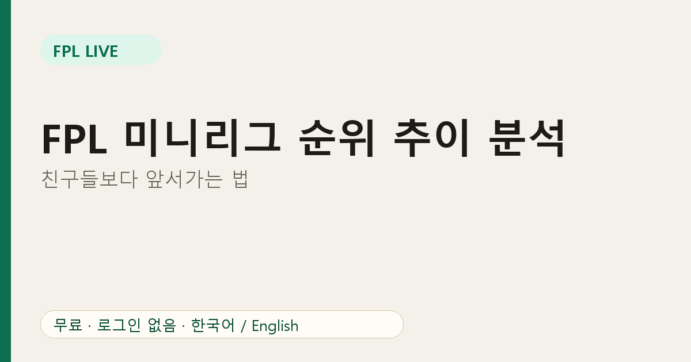
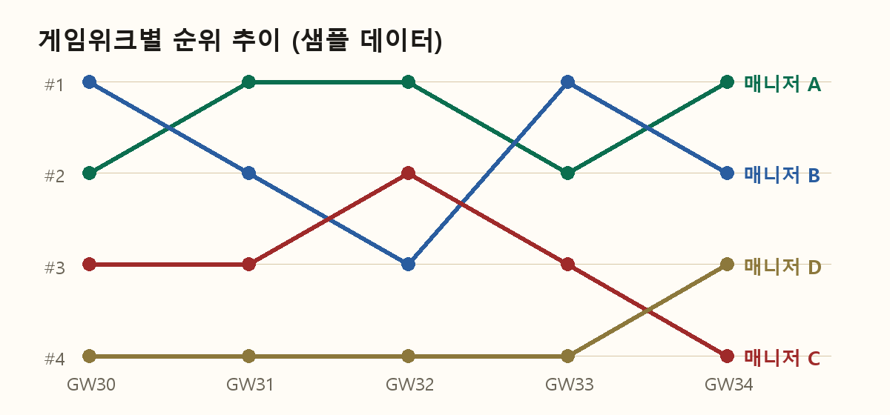

# FPL 미니리그 순위 추이 분석: 친구들보다 앞서가는 법

총점은 지금 어디에 있는지를 알려 주고, **순위 추이**는 어디로 가고 있는지를 알려 줍니다. FPL Live는 내가 실제로 경쟁하는 사람들을 기준으로 둘 다 보여 줍니다.

## 두 가지 움직임

**게임위크 중**에는 골, 어시스트, 보너스가 들어올 때마다 순위가 바뀝니다. 주간 순위 탭은 잠정 점수로 실시간 순서를 보여 주니, 경기 중 누가 올라오는지 알 수 있습니다.

**시즌 전체**는 순위 추이 화면에서 매니저별 순위를 게임위크 단위로 그려 줍니다.

위 그래프는 개념을 보여 주기 위한 샘플 데이터입니다. A는 초반에 앞섰고, B는 내려갔다가 회복했고, C는 계속 밀려났습니다.

## 무엇을 볼까

1. **기세.** 세 주 연속 올라온 매니저는 폼이 좋거나 잘 맞는 선수 구성을 찾은 것입니다. 무엇을 보유했는지 살펴보세요.
2. **변동성.** 선이 들쭉날쭉하면 큰 캡틴, 차별화 선수, 칩을 쓰는 공격적인 스타일입니다. 급등하거나 급락할 수 있습니다.
3. **격차.** 바로 위 라이벌은 목표입니다. 다섯 칸 아래 라이벌은 선이 올라오고 있을 때만 경계하면 됩니다.

## 실전 활용

- 매 게임위크 후 순위 추이 탭에서 가장 많이 오른 사람을 확인합니다.
- 리그 선수 화면에서 그 매니저가 무엇을 보유했는지 비교하고 이유를 생각해 봅니다.
- 한 달에 한 칸 올라가기처럼 작은 목표를 두면 긴 시즌이 재미있어집니다.

## 경기 중에는

경기일에 탭을 켜 두고, 골 직후에는 새로고침 버튼으로 바로 갱신하세요. 순위는 자동으로도 갱신되지만 수동 새로고침이 편할 때가 있습니다.

## 자주 묻는 질문

**순위 추이도 로그인이 필요한가요?** 아니요, 리그 ID만 있으면 됩니다.

**종료 후 순위가 바뀌는 이유는?** 잠정 보너스가 공식 보너스로 대체되기 때문입니다. [보너스 점수 설명](05-fpl-bonus-points-live.md)을 참고하세요.

내 리그 열기: [FPL Live](https://fpl-live-production-34f4.up.railway.app/?ref=blog-ko-06)
