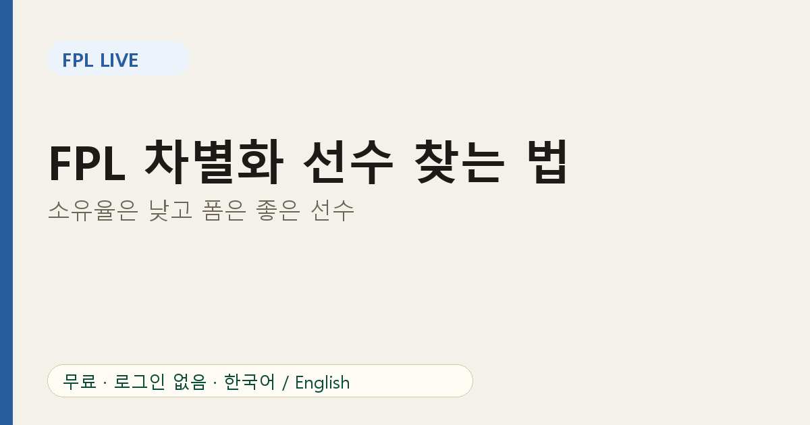
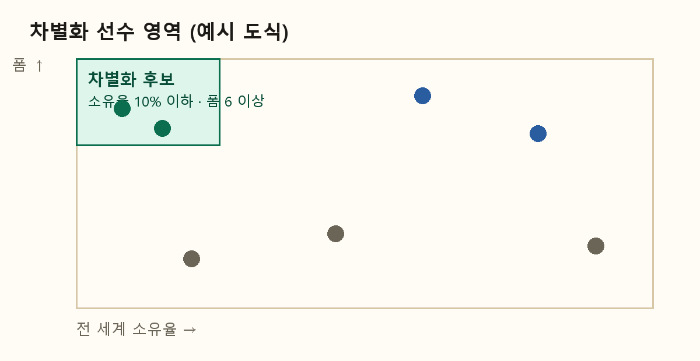

# FPL 차별화 선수 찾는 법: 소유율은 낮고 폼은 좋은 선수

미니리그 모두가 같은 선수를 보유하면 순위가 거의 움직이지 않습니다. 라이벌을 앞지르려면 **그들이 갖지 않은 선수**에게서 점수가 나와야 합니다. 이것이 차별화(디퍼렌셜) 선수의 개념입니다.

## 차별화 선수란?

적은 수의 매니저만 보유하면서도 점수를 낼 수 있는 선수입니다. 보유자가 적을수록 좋은 활약이 다른 사람과의 격차를 더 크게 벌려 줍니다.

## 간단한 기준

FPL Live에서는 다음 조건을 만족하는 선수를 차별화 후보로 봅니다.

- 전 세계 **소유율 10% 이하**
- **폼 6 이상**

이 숫자는 게임 규칙이 아니라 기본값입니다. 5%는 더 과감하고 15%는 더 안전하다고 보면 됩니다.

## 전 세계 기준 vs 우리 리그 기준

전 세계에서는 차별화 선수여도 우리 리그에서는 아닐 수 있습니다. 라이벌 7명 중 5명이 가졌다면 전 세계 소유율이 8%여도 나에게는 차별화가 아닙니다. 그래서 리그 선수 화면에서 **내가 경쟁하는 사람들**의 보유 현황을 확인하는 것이 중요합니다.

## 고르는 순서

1. 가격이 아니라 폼에서 출발합니다. 싼 선수가 점수를 못 내면 차별화가 아니라 실패입니다.
2. [팀 메뉴](https://fpl-live-production-34f4.up.railway.app/?ref=blog-ko-07)의 일정 난이도로 앞으로 몇 경기를 확인합니다.
3. 출전 시간을 확인합니다. 벤치에 있으면 점수가 없습니다.
4. 라이벌과 비교합니다. 바로 위와 격차가 작다면 차별화 한 장이 격차를 줄일 수 있습니다.

## 위험 관리

차별화는 본질적으로 변동성이 큽니다. 스쿼드 대부분은 안정적으로 두고 한두 자리만 사용하세요. 앞서 있다면 안전하게, 쫓고 있다면 더 과감하게 가면 됩니다.

## 자주 묻는 질문

**차별화 선수는 늘 싼 선수인가요?** 아닙니다. 비싼 선수도 차별화가 될 수 있습니다.

**얼마나 들고 있어야 하나요?** 기간이 아니라 폼과 일정이 바뀔 때까지입니다.

관련 글: [캡틴 선택과 유효 소유율](08-fpl-captain-effective-ownership.md)
