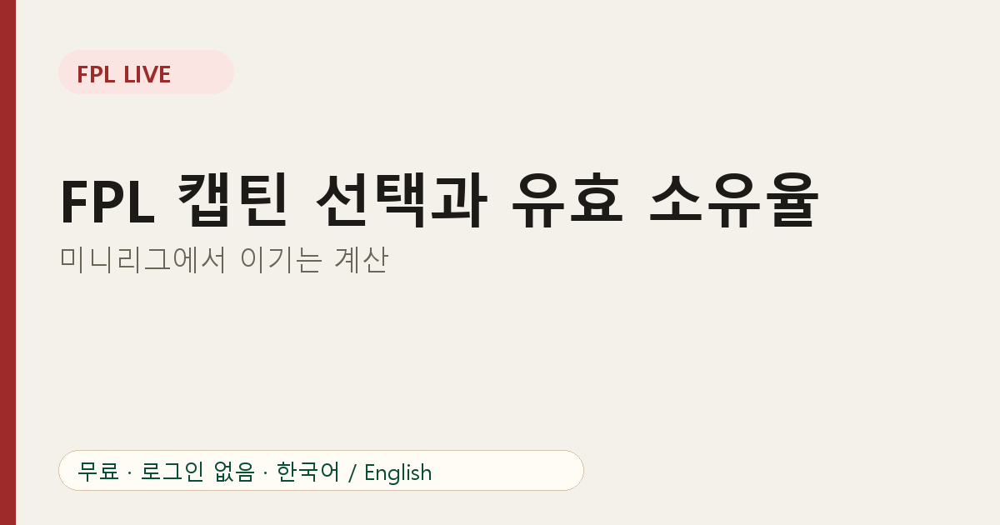

# FPL 캡틴 선택과 유효 소유율(EO): 미니리그에서 이기는 계산

소유율은 투박한 숫자입니다. 선수를 **보유한** 스쿼드 수만 세고, 그 선수가 각 스쿼드에서 **얼마나 중요한지**는 반영하지 않습니다. **유효 소유율(EO)**이 이 부분을 보완합니다.

## EO가 재는 것

EO는 캡틴을 포함해 선수의 점수를 얼마나 가져가는지를 봅니다.

- 선발은 1번으로 계산합니다.
- 캡틴은 점수가 두 배이므로 2번으로 계산합니다.
- 벤치는 해당 게임위크에 0으로 계산합니다.

보유율이 40%이고 그중 절반이 캡틴으로 썼다면 EO는 40%보다 훨씬 높습니다. 미니리그에서는 같은 계산을 **내가 경쟁하는 매니저들**만으로 할 수 있습니다.

## 왜 중요한가

라이벌이 어떤 공격수를 캡틴으로 썼고 나는 갖고 있지 않다고 합시다. 그 선수가 대량 득점하면 라이벌은 두 배를 얻고 나는 아무것도 얻지 못합니다. EO는 이 노출 위험을 경기 **전에** 보여 줍니다.

## 우리 리그에서 읽는 법

리그 선수 화면에는 선수별 보유자, 캡틴 지정자, 선발 수가 나옵니다. 이것으로 다음을 확인하세요.

1. **리그에서 가장 많이 보유한 선수는?** 그를 건너뛰면 차별화 성격의 위험을 지는 것입니다.
2. **가장 많이 캡틴으로 쓰는 선수는?** 내가 다른 캡틴을 쓴다면 그 선수보다 더 많은 점수를 내야 합니다.
3. **내가 노출된 곳은?** 라이벌은 갖고 있고 나는 없는 선수가 가장 큰 하방 위험입니다.

## 실전 캡틴 결정

- **앞서 있다면** 가까운 라이벌과 같은 캡틴으로 상대의 상방을 지우는 쪽이 유리합니다.
- **쫓고 있다면** 다른 캡틴으로 변동성을 감수할 수 있습니다.
- 출전 시간과 일정은 항상 우선입니다. EO는 참고 자료일 뿐 선발이 불확실한 선수를 캡틴으로 쓸 이유가 되지 않습니다.

## 한계

EO는 누가 실제로 뛰는지, 누가 자동 교체되는지 모릅니다. 선택 현황의 스냅숏입니다. [차별화 선수](07-fpl-differential-players.md)와 본인의 판단을 함께 쓰세요.

## 자주 묻는 질문

**EO는 공식 통계인가요?** 개념은 FPL 커뮤니티에서 널리 쓰이며, FPL Live의 수치는 우리 리그 스쿼드로 계산한 값입니다.

**부캡틴도 계산하나요?** 캡틴이 뛰지 않을 때만 적용되므로 경기 전에는 알 수 없습니다.

우리 리그 수치 보기: [FPL Live](https://fpl-live-production-34f4.up.railway.app/?ref=blog-ko-08)
