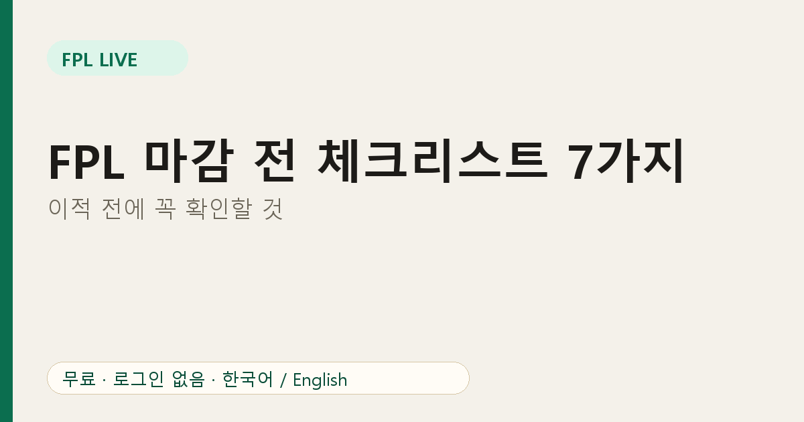
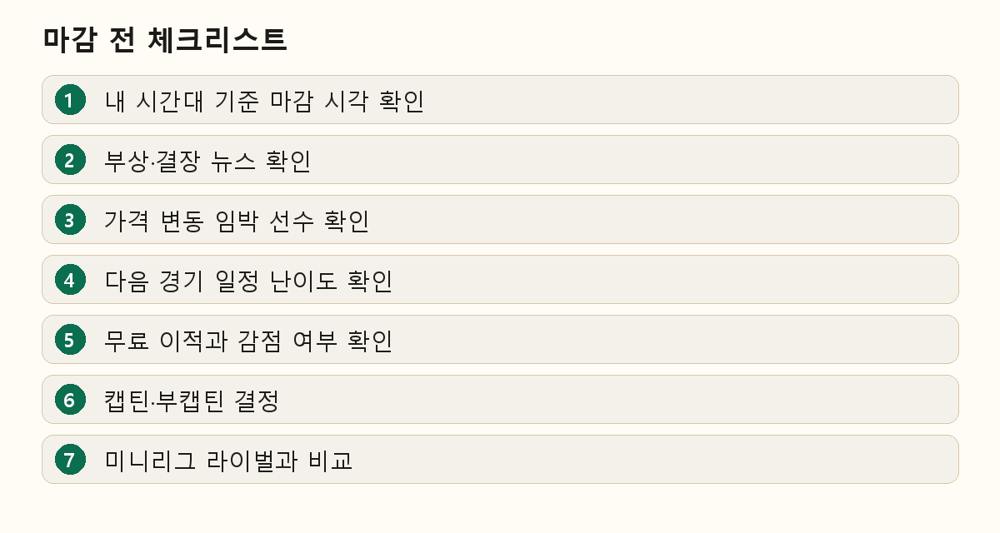

# FPL 마감 전 체크리스트 7가지: 이적 전에 꼭 확인할 것

FPL 후회는 대부분 마감 10분 전에 일어납니다. 놓친 부상, 깜빡한 캡틴, 급하게 한 이적이 그렇습니다. 짧은 루틴이면 대부분 막을 수 있습니다. 5분이면 끝나는 순서를 소개합니다.

## 1. 내 시간대의 마감 시각 확인

마감은 보통 그 게임위크 첫 경기 약 90분 전이지만 달라질 수 있습니다. FPL Live의 배너는 **내 시간대**로 마감 시각과 남은 시간을 보여 주어 시차 착오를 막아 줍니다.

## 2. 부상·결장 뉴스 확인

스쿼드에 표시가 붙은 선수를 보세요. 불확실한 선수는 뛸 수도 있지만 위험은 내 몫입니다. 결장이 확정된 선수는 교체하세요.

## 3. 가격 변동 임박 선수 확인

[가격 변동 예측](https://fpl-live-production-34f4.up.railway.app/price-changes?ref=blog-ko-09)을 열어 보세요. 사려는 선수가 곧 오를 가능성이 크면 지금 사는 것이 유리하고, 팔려는 선수가 곧 내릴 가능성이 크면 먼저 파는 것이 예산을 지킵니다. 자세한 읽는 법은 [가격 변동 예측 보는 법](03-fpl-price-change-prediction.md)에 있습니다.

## 4. 앞으로의 일정 확인

팀 메뉴의 일정 난이도 표로 앞으로 몇 게임위크를 비교하세요. 한 경기의 쉬운 상대보다 이어지는 좋은 일정이 더 중요합니다.

## 5. 무료 이적과 감점 확인

추가 이적은 점수를 깎습니다. 이적으로 얻는 점수가 감점보다 앞으로 몇 주 동안 더 큰지 따져 보세요.

## 6. 캡틴·부캡틴 결정

출전 시간, 폼, 좋은 일정이 있는 선수를 캡틴으로 정하고, 부캡틴은 캡틴이 뛰지 않을 때를 대비합니다.

## 7. 미니리그 라이벌과 비교

리그 선수 화면에서 라이벌이 보유한 선수와 캡틴을 확인하세요. 앞서 있다면 차이를 줄이고, 쫓고 있다면 승부처를 고르세요. [유효 소유율](08-fpl-captain-effective-ownership.md)도 참고하세요.

## 마지막으로

스쿼드를 한 번 더 열어 선발 11명과 벤치 순서를 확인하고 이적이 반영됐는지 보세요. 그다음 앱을 닫고 경기를 즐기면 됩니다.

## 자주 묻는 질문

**마감 후에도 팀을 바꿀 수 있나요?** 그 게임위크에는 바꿀 수 없습니다.

**깜빡하면 어떻게 되나요?** 이전 팀이 그대로 유지되지만 새 소식에 대응할 기회를 잃습니다.

킥오프 전에 리그 화면을 준비해 두세요: [FPL Live](https://fpl-live-production-34f4.up.railway.app/?ref=blog-ko-09)
