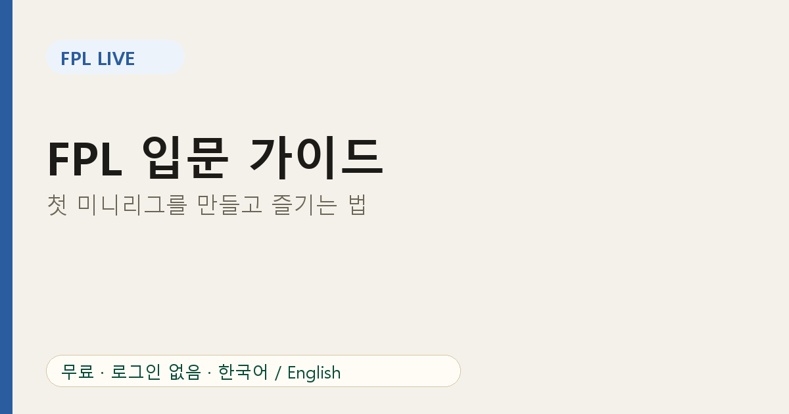

# FPL 입문 가이드: 첫 미니리그를 만들고 즐기는 법

FPL(판타지 프리미어리그)은 프리미어리그 선수들로 가상의 팀을 꾸리고 실제 경기 활약으로 점수를 얻는 무료 게임입니다. 혼자 해도 재미있지만 **미니리그**에서 친구와 경쟁하면 훨씬 오래 즐길 수 있습니다.

## 1단계: 팀 만들기

공식 웹사이트나 앱에서 계정을 만들고, 정해진 예산으로 15명을 고릅니다. 포지션별 인원 제한과 한 구단에서 최대 3명이라는 제한이 있습니다. 처음에는 폼이 좋고 선발이 확실한 선수 위주로 고르면 충분합니다.

## 2단계: 미니리그 만들기

Leagues & Cups 메뉴에서 클래식 리그를 만들면 초대 코드가 생깁니다. 친구에게 코드를 보내 참여하게 하세요. 리그가 만들어지면 [FPL 리그 ID 확인 방법](02-fpl-league-id-check.md)으로 숫자를 확인해 두세요.

## 3단계: FPL Live로 지켜보기

[FPL Live](https://fpl-live-production-34f4.up.railway.app/?ref=blog-ko-10)에 리그 ID를 입력하면 로그인 없이 실시간 순위와 순위 추이를 볼 수 있습니다. 친구에게 링크만 공유해도 함께 볼 수 있습니다.

## 시즌을 즐기는 기본 루틴

| 시점 | 할 일 |
|---|---|
| 마감 전 | 부상 뉴스, 일정, 가격 변동 확인 |
| 경기 중 | 실시간 순위 보기 |
| 게임위크 후 | 순위 추이로 흐름 점검 |

## 초보자가 자주 하는 실수

- **너무 잦은 이적.** 추가 이적은 점수를 깎습니다. 이적은 필요할 때만 하세요.
- **이름값만 보고 고르기.** 유명해도 출전하지 않으면 점수가 없습니다.
- **캡틴을 깜빡하기.** 캡틴은 점수가 두 배입니다. 마감 전에 꼭 확인하세요. 체크리스트는 [마감 전 7가지](09-fpl-deadline-checklist.md)에 있습니다.

## 조금 익숙해지면

[가격 변동](04-fpl-price-rise-fall-principle.md)으로 예산을 아끼고, [차별화 선수](07-fpl-differential-players.md)로 친구와 격차를 만들어 보세요. 캡틴 선택은 [유효 소유율](08-fpl-captain-effective-ownership.md)을 참고하면 더 좋아집니다.

## 자주 묻는 질문

**FPL은 무료인가요?** 공식 게임은 무료입니다.

**하루에 얼마나 시간을 써야 하나요?** 마감 전 5분 정도면 충분합니다.

**한국어로 볼 수 있나요?** FPL Live는 한국어와 영어를 지원합니다.

지금 [FPL Live](https://fpl-live-production-34f4.up.railway.app/?ref=blog-ko-10)에서 우리 리그를 열어 보세요.

*FPL Live는 비공식 팬 서비스이며 프리미어리그, FPL과 제휴 관계가 없습니다.*
